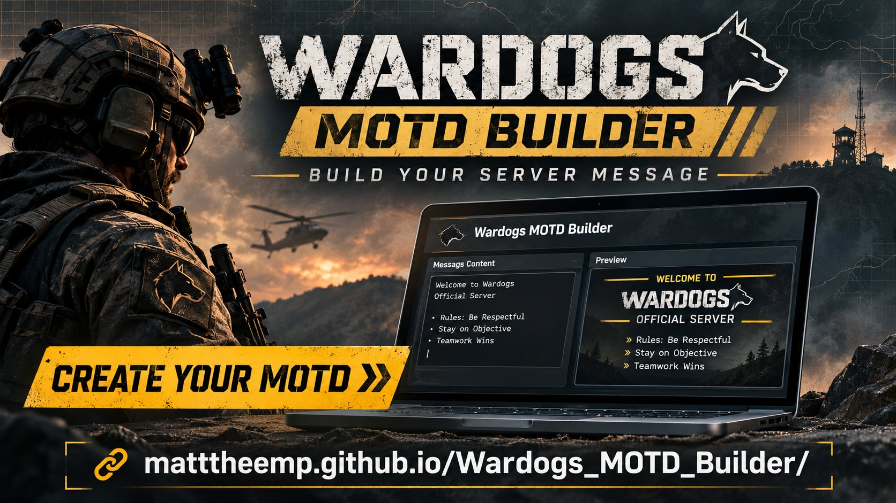

# Wardogs MOTD Builder

[](https://matttheemp.github.io/Wardogs_MOTD_Builder/)

A browser tool for writing **Wardogs server welcome messages** (the MOTD popup players see on join).
Type on the left, see the popup on the right, and get told exactly which line RCON will refuse, and why, before you paste it in.

**Live site:** https://matttheemp.github.io/Wardogs_MOTD_Builder/

## Features

- **Live in-game preview** of the popup: headers, bold/italic, custom colors and sizes, blank-line spacers, wrapping, and scrolling. Characters past the 128 limit show struck through, and lines past line 128 are greyed out.
- **Spec checker** that flags every rule from the WARDOGS team, one line at a time:
  unclosed tags, nested tags, `</Bold>`-style closers, Header with color/size, unknown tags and links,
  bad colors, sizes outside 8–24, bad `fontface`, smart quotes pasted from Discord, unescaped `< > &`,
  and the 128-line and 128-character limits.
- **Auto-format**: paste plain text (a Discord rules post, a doc) and it becomes a styled MOTD: the first line becomes the
  Header, ALL-CAPS lines become amber section headings, short title lines become bold sub-headings, lists get bullets,
  `Label: text` gets a bold label, long lines are split at sentence breaks to stay under 128 characters, and
  special characters are escaped. Works on the selected lines or the whole message, and `Ctrl+Z` undoes it.
- **Auto-fix**: straightens quotes, escapes special characters, fixes tag case, closes and un-nests tags,
  clamps sizes, and turns `<Header color=…>` into the equivalent `<text>` title. It won't shorten a line that's over the limit; you decide what to cut.
- **Toolbar**: wrap selected text in Header / Bold / Italic, apply a `<text>` style (color swatches, size, face),
  clear styling, insert `&lt; &gt; &amp; &quot;`. `Ctrl+B` and `Ctrl+I` work too.
- **Per-line character counter** (tags don't count, and each `&lt;` counts as 1).
- **Templates**, **saved messages** (stored in your browser), **share links** that carry the whole MOTD in the URL,
  open/download `.txt`, and one-click **Copy MOTD**.

## Message format (quick reference)

```text
<Header>Welcome to Dogpile</>                       big title
<Bold>No cheating</>                                bold
<Italic>Have fun</>                                 italic
<text color="#E8A33D" size="16" fontface="Bold">EU Hardcore KOTH</>
Keep chat in <text color="#7FD6FF">English</> and be respectful
```

- One line = one popup line. An empty line is a spacer. Long lines wrap; tall messages scroll.
- Close every tag with `</>`. Several tags on one line are fine; tags inside tags are not.
- `<text>` attributes: `color="#RRGGBB"`, `size="8"`–`"24"`, `fontface="Bold"` or `"Italic"`.
- `Header` takes no attributes. For a colored title use `<text size="20" fontface="Bold" color="#FF4D4D">`.
- Links and any other tag are **not** clickable. They show as typed and RCON refuses the line.
- Show `< > & "` with `&lt; &gt; &amp; &quot;`.
- Limits: 128 lines, 128 visible characters per line, font size 8–24. Anything over is cut in game and RCON refuses to Apply.

## Repo layout

| Path | What |
| --- | --- |
| `index.html`, `css/`, `js/app.js` | The builder UI (static, no build step) |
| `js/motd.js` | Parser, validator and auto-fixer. Works in the browser and in Node |
| `js/templates.js` | Starter templates |
| `assets/` | Banner image (README + link previews) |
| `motds/` | Saved server messages as `.txt`. CI validates each one |
| `tests/` | `node --test` suite for the spec rules |
| `.github/workflows/deploy.yml` | Runs tests, then publishes to GitHub Pages |

## Develop

No dependencies. Open `index.html` directly, or:

```bash
npm run serve   # http://localhost:8080
npm test        # validator + templates + everything in motds/
```

## Notes

- The preview approximates the in-game popup. Fonts and the exact popup size in game may differ.
- Saved messages live in your browser's local storage. To keep one for good or share it with other admins, download it and commit it to `motds/`.
